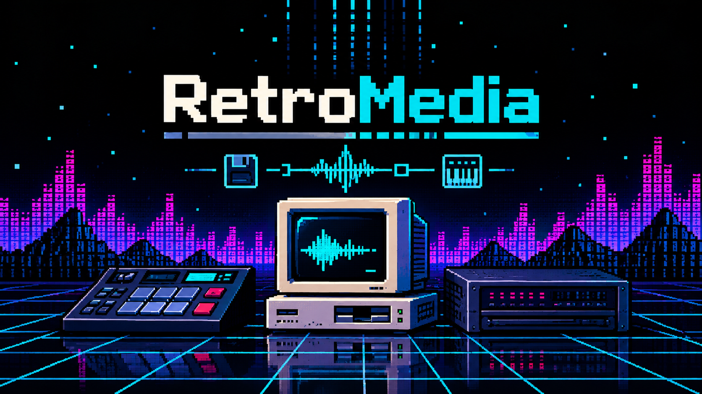

# RetroMedia



Copy files on and off the disk images that floppy and hard disk emulators use, on a Mac. By Ed Davis.

RetroMedia is for anyone with a Gotek floppy emulator (FlashFloppy or HxC) or a SCSI-to-SD adapter (ZuluSCSI, BlueSCSI, SCSI2SD…) in a vintage computer, synth or sampler. It opens their images directly, so nothing has to be mounted, and it reads CD images (`.iso`) too. It grew out of [MPC Blaster](https://github.com/Ed-Davis/MPCDisk) and [Floppy Blaster](https://github.com/Ed-Davis/FloppyBlaster), without their sampler-specific features: files keep their names, and nothing is converted.

## What it does

- **Opens several images at once**, listed in a sidebar: floppies, each partition of a hard disk image, Akai floppies and CDs. Choose your Gotek USB stick or SD card as the library folder to list every image on it.
- **Copies files and folders** from Finder onto an image (drop them, or Add Files…), between images (drag onto another disk in the sidebar, or Copy To), and back to your Mac (drag to Finder, or Export…). Same-name conflicts: replace, keep both or skip. Nothing is copied if it won't fit.
- **Keeps file names.** Long names on FAT disks are written as VFAT long names with a Windows-style 8.3 alias (`LONGNA~1.TXT`) for older machines, which is shown beside each long name.
- **Renames, deletes, makes folders** and sets the volume label. **Remove Mac Files** clears `.DS_Store` and `._` files.
- **New images:** DOS floppies (720 KB, 1.44 MB, 2.88 MB), Akai S1000/S3000 floppies, and hard disk images from 16 MB as FAT16 (partitions of up to 2 GB, up to four) or FAT32.
- **Plays audio files** for a quick listen, and **backs up** an image before big changes.

## Formats

| | Read | Write | Notes |
|---|---|---|---|
| FAT12 floppies | ✓ | ✓ | 720 KB, 1.44 MB, 2.88 MB and other sizes |
| FAT16 / FAT32 hard disk images | ✓ | ✓ | whole-disk ("superfloppy") or MBR with up to four partitions |
| Akai S1000 / S3000 floppies | ✓ | ✓ | files copied as they are (`NAME.s3`, `NAME.p1`…); samples move between families |
| ISO 9660 CD images | ✓ | — | Joliet long names; multi-extent files |

Not supported: exFAT, HFS/HFS+, Amiga, Atari ST and other non-DOS floppy formats, GPT partition tables, and `.bin/.cue` raw CD images.

## Safety

Nothing is mounted: RetroMedia reads and writes the filesystems itself (`pread`/`pwrite` on the image file), which is what lets it run in the App Store sandbox. New data is written first, then the allocation table, then the directory entries that make it visible, so an interruption can lose only free space. Deleting works the other way round. Every change is flushed to the card. Close an image before ejecting.

## Building

- `swift test` runs the tests. They make floppies and hard disk images, write long names, folders and files to them, and check the results with macOS's own `fsck_msdos` and by mounting them; CD images are made with `hdiutil makehybrid`.
- `./make-dmg.sh` builds `build/RetroMedia.app` (sandboxed, ad-hoc signed) and a test DMG. Set `SIGN_IDENTITY` to sign with your Developer ID.
- CI builds and tests on every push and uploads the DMG as **RetroMedia-test-dmg**. Pushing a `test-release/…` branch publishes a test pre-release.

```
Sources/RetroMediaCore/   FAT12/16/32 with long names, disk images and image making,
                          Akai floppies, ISO 9660, and copying between them
Sources/RetroMedia/       The SwiftUI app
Tests/                    Format, copying and macOS cross-checks
```

© 2026 Ed Davis. Not affiliated with the makers of Gotek, FlashFloppy, ZuluSCSI, BlueSCSI, SCSI2SD or Akai Professional.
